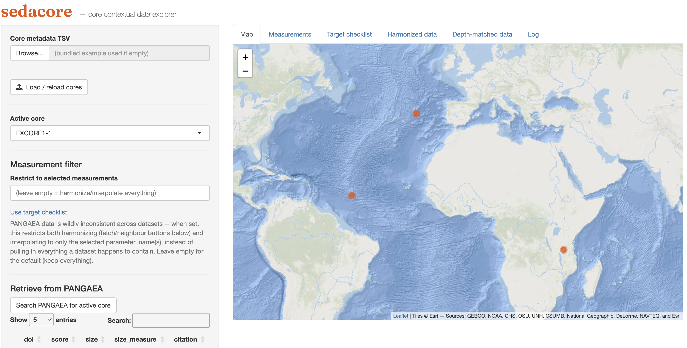

# sedacore

Discover, retrieve, and harmonize contextual data for marine sediment cores —
built to generalize the ad hoc PANGAEA-parsing scripts in `sedaDNA_atlantic_LGM`
into a reusable tool for sedaDNA (and other) meta-analyses.

Given a core metadata file (one row per subsample, with `core_id`,
`latitude`, `longitude`, `water_depth`, ...), `sedacore` will:

1. Map the cores.
2. Retrieve matching PANGAEA datasets automatically (via `pangaear`).
3. Find neighbouring cores within a radius and optionally retrieve their data.
4. Harmonize units and column names into one long table, interpolating
   missing depths where data density allows.
5. Extend the same retrieval machinery to IODP cores via PANGAEA's IODP
   campaign index.



## Installation

**Requirements**

- R >= 4.1.0 (the code uses the native pipe `|>`).
- System libraries for `sf`: GDAL, GEOS, PROJ. On macOS: `brew install gdal
  geos proj`. On Ubuntu/Debian: `apt install libgdal-dev libgeos-dev
  libproj-dev`. On Windows this is normally handled automatically by CRAN's
  binary `sf` build.
- Internet access: PANGAEA retrieval and neighbour search make live API
  calls; only the map/visualization functions work fully offline on a local
  file.

```r
remotes::install_github("sedaDNA-MARUM/sedacore")
```

Alternatively, install from a local clone:

```r
remotes::install_local("/path/to/sedacore")

# or, for active development (re-run after editing source):
devtools::load_all("/path/to/sedacore")
```

`install_github()`/`install_local()` install the R package dependencies
listed in `DESCRIPTION` automatically, but **not** the system GDAL/GEOS/PROJ
libraries above -- install those first, or `sf` won't compile.

**Running it**

```r
library(sedacore)

# interactive app: map -> retrieve from PANGAEA -> find neighbours -> export
run_sedacore_app()

# or drive the pipeline directly from a script/console
sr <- as_sample_registry(readr::read_tsv("my_core_metadata.tsv"))
cr <- collapse_to_core_registry(sr)
plot_core_map(cr)
```

Bring your own `core_metadata.tsv`-shaped file (see "Input format" below),
or use the bundled synthetic example (`inst/extdata/example_core_metadata.tsv`),
which the app loads by default.

## Input format

The input file is **one row per subsample**, not one row per core --
`sedacore` collapses it to one row per core internally
(`collapse_to_core_registry()`) for the map/retrieval/neighbour-search
steps, but keeps the per-sample rows too, because the "Interpolate to
active core's sample depths" feature needs real sample depths to
interpolate *onto*.

Only four columns are required (as read by `as_sample_registry()`; all
column names are configurable arguments if your file uses different ones
-- see `?as_sample_registry`):

| Column      | Type      | Meaning                                                                 |
|-------------|-----------|--------------------------------------------------------------------------|
| `core_id`   | character | The physical-core grouping key (e.g. `"GeoB9064-1"`) -- this is what samples get collapsed/mapped/retrieved by. Defaults to reading from a column named `sample_source`. |
| `latitude`  | numeric   | Decimal degrees. Assumed constant within a core.                        |
| `longitude` | numeric   | Decimal degrees. Assumed constant within a core.                        |
| `depth_cm`  | numeric   | The depth of this particular sample below the core top, **in centimetres** -- the target depths `interpolate_depth_series()` matches/interpolates onto. |

Everything else is optional and filled in sensibly if absent.

<!----------------
| Column          | Type      | Meaning                                                                 |
|-----------------|-----------|--------------------------------------------------------------------------|
| `water_depth_m` | numeric   | Metres. Assumed constant within a core; shown in map popups only. `NA` if absent. |
| `core_label`    | character | Human-readable label (e.g. `"GeoB1706-2; 2003"`, often including the retrieval year), passed through for display. Left out entirely if absent -- falls back to `core_id` itself. |
| `sample_id`     | character | Unique ID for this subsample row. Auto-generated (`"<core_id>_<row number>"`) if absent. |
| `age_ka`        | numeric   | This sample's age, in ka. Passed through, not currently used by any pipeline step. `NA` if absent. |
------------------>

Minimal example (see `inst/extdata/example_core_metadata.tsv` for a
fuller one with optional columns too):

```
core_id    latitude  longitude  depth_cm
EXCORE1-1     40.1      -20.5     10
EXCORE3-3     2.4       -45.2     15
U1499A       -8.3        35.6     50
```

```r
sr <- as_sample_registry(readr::read_tsv("my_core_metadata.tsv"))
```

If you only care about the map/retrieval/neighbour-search/export steps and
not per-sample depth-matching, you can still use this format with a single
placeholder row per core (e.g. `depth_cm = 0`) -- just be aware the
Interpolate feature will then only ever target that one depth.
